## <h1 align="center">Project Continuation</h1>

This repository contains the data analysis phase of the ShopFlow project. Data cleaning and preparation were completed in a separate repository during the previous stage.

🔗 Previous stage: [SHOPFLOW-DATA-CLEANING](https://github.com/asiawaldoch/SHOPFLOW-DATA-CLEANING)

<h1 align="center">ShopFlow – Project Overview</h1>

## Tools: PostgreSQL + DBeaver, Microsoft Excel, Copilot

The data comes from a simulated online store called ShopFlow, operating in the Polish e-commerce market across the fashion, electronics, home & living, and beauty sectors. The dataset contains approximately 85,000 records distributed across five related tables. The data covers 24 months of sales history and intentionally includes common real-world data quality issues such as duplicates, missing values, inconsistent formats, and outliers. These issues were identified and resolved as part of the project.

## Data Structure

| Table | Number of Records | Contents |
|---------|---------:|---------|
| customers | ~5,000 | Customer data, including location, acquisition channel, registration date, and loyalty program membership |
| products | ~2,000 | Product catalog containing category, brand, price, cost, and date added to the assortment |
| orders | ~20,000 | Order headers, including customer, order date, status, payment method, order value, and marketing channel |
| order_items | ~49,000 | Order line items, including product, quantity, purchase price at the time of sale, and discount |
| inventory | 2,000 | Inventory records, including stock quantity, replenishment threshold, and warehouse location |

## Business Context: 
ShopFlow is an online retailer operating in the Polish e-commerce market, offering products across eight categories: women's fashion, men's fashion, home & living, electronics, beauty, sports, children, and accessories. The sales data covers 24 months of the company's operations and exhibits clear seasonal trends, including increased sales during November and December (driven by Black Friday and the holiday shopping season) as well as a noticeable decline in January.

## Data Characteristics: 
The dataset was designed to reflect the data quality challenges commonly encountered in real-world transactional systems. It includes duplicate records, missing values, inconsistent formats (dates, phone numbers, postal codes, city names, and product categories)and price outliers. All of these issues were identified and resolved during the data cleaning phase of the project using SQL and PostgreSQL before proceeding with the main business analysis.

## Business Problem: 
- **Rising Customer Acquisition Cost (CAC)**  
  Customer acquisition cost has increased by 34% year-over-year, while the marketing team lacks clear visibility into which channels generate the most valuable customers.
- **Low Customer Retention**  
  Only around 22% of customers place a second order within six months of their first purchase.
- **Inventory Management Issues**  
  Best-selling products are frequently out of stock, resulting in lost sales opportunities. At the same time, other products remain in inventory for months, increasing storage and holding costs.
- **Lack of Profitability Visibility**  
  The company does not have a clear understanding of the actual profit margins generated by individual product categories.
- **Inconsistent Reporting Across Departments**  
  Marketing, sales, and inventory teams rely on different metrics and reports, making it difficult to align on business performance and make data-driven decisions.
- **Unclear Marketing Spend Allocation**  
  A significant portion of the marketing budget is invested without a clear understanding of which channels provide the highest return on investment.
## Project Objective

The objective of this project was to perform a complete analytical workflow consisting of:

1.	Data quality assessment.
2.	Data cleaning and standardization.
3.	Identification of data quality issues.
4.	Exploratory business analysis.
5.	Generation of actionable business recommendations.

## <h1 align="center">6.	ANALYSIS</h1>
## Question 1: Which categories generate the highest revenue?

  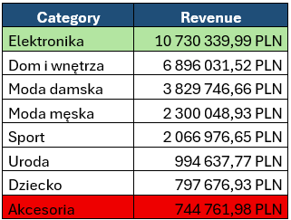

 

  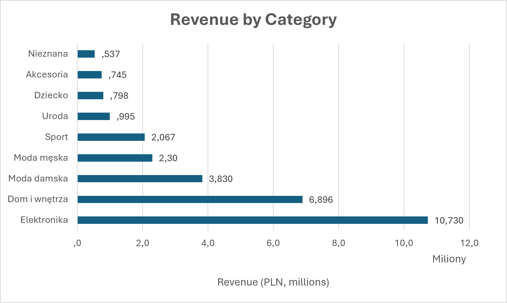

## Observations 
Elektronika represents 37.13% of total revenue — PLN 10.73m out of PLN 28.90m. Akcesoria, dziecko and uroda represents the lowest revenue.
Recommendiation: The Electronics category should remain a strategic business priority and receive a significant share of marketing and promotional resources. Due to its substantial contribution to overall revenue, the category should be prominently featured on the website and in advertising campaigns. However, revenue should be analyzed together with profitability metrics, as high revenue does not necessarily translate into high margins.

## Question 2: Which categories have the highest and lowest profit margins?

  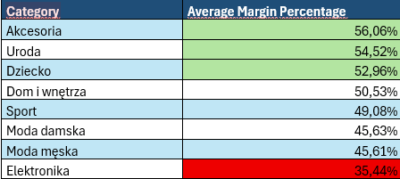

## Observation
Although Electronics is the largest revenue-generating category (PLN 10.7 million), it also has the lowest average profit margin (35.44%) among all categories. In contrast, Accessories (56.06%) and Beauty (54.52%) achieve the highest margins despite generating substantially lower revenue.
This suggests that Electronics operates as a high-volume, lower-margin category, while Accessories and Beauty generate greater profit per unit sold.

## Recommendation
Continue prioritizing the Electronics category due to its significant contribution to revenue. However, profitability can be further improved by implementing a cross-selling strategy.
Customers purchasing electronics should be actively presented with complementary accessory products during the shopping journey.
These products typically generate higher margins and can increase both the average order value and overall profitability without significantly increasing customer acquisition costs.

## Question 3:  Which products have high sales but low margins?

  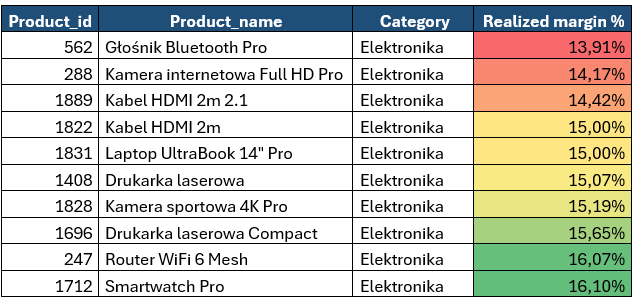

## Observation
All products with the lowest realized margins belong to the Electronics category. Their realized margins are between 13.9% and 16.1%, which is much lower than the average margin for Electronics (35.4%).
This confirms the earlier finding that Electronics generates the highest revenue, but at the same time has the lowest profitability among all categories.

## Recommendation
Review supplier prices for the 10 products with the lowest margins and try to negotiate better purchase prices. Also, check if these products receive discounts too often, as their margins are already low. In addition, show high-margin accessories as recommended products when customers buy electronics to increase overall profit.

## Question 5: How does sales performance change from month to month?

  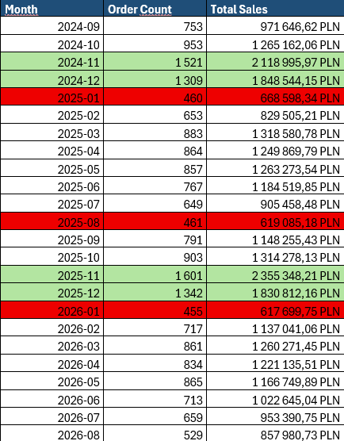

  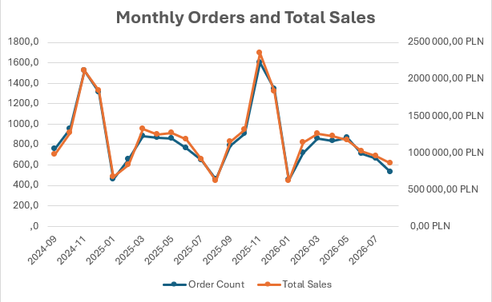

## Observation
Sales show a clear seasonal pattern. The highest sales and order volumes occur in November and December in both years:
•	November 2024: 1,521 orders, PLN 2.12M
•	November 2025: 1,601 orders, PLN 2.36M (highest month)
After the holiday season, sales drop significantly in January:
•	January 2025: 460 orders, PLN 669K
•	January 2026: 455 orders, PLN 618K
This suggests that customer demand is strongly influenced by Black Friday and Christmas shopping periods.
The number of orders and total sales move almost identically throughout the entire period. This means that revenue growth is mainly driven by changes in order volume rather than major changes in average order value.

## Recommendation
The company should increase marketing activity and inventory levels before November and December to take advantage of peak demand. Special attention should also be given to January, when sales drop sharply. To reduce the post-holiday slowdown, the company could launch retention campaigns, loyalty offers, or targeted promotions for existing customers.

## Question 3: Which customers are most likely to make a repeat purchase?

  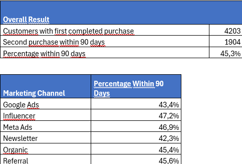

## Observation
Out of 4,203 customers who made their first completed purchase, 1,904 customers (45.3%) made a second purchase within 90 days.
The differences between marketing channels are relatively small, which suggests that customer retention is fairly consistent across acquisition channels.
Influencer customers have the highest repeat purchase rate (47.2%), followed by Meta Ads (46.9%). The lowest repeat purchase  lace d observed for Newsletter (42.3%) and Google Ads (43.4%).
Although Influencer has the highest repeat purchase rate, Meta Ads generates a much larger customer base and a similar retention rate, making it the most impactful acquisition channel overall.

## Recommendation
Customers acquired through Influencer and Meta Ads campaigns show the strongest retention and should be considered for additional marketing investment.
At the same time, the company should review the quality of customers acquired through Google Ads and Newsletter campaigns, as they are less likely to make a second purchase within 90 days.
Since more than half of customers do not return within 90 days, the company could also introduce targeted retention campaigns, loyalty incentives, and personalized product recommendations to encourage repeat purchases.

## Question 6: How many registered customers have placed an order?

  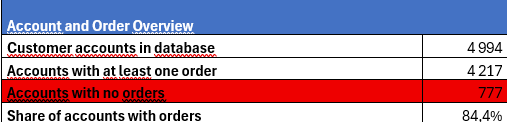

  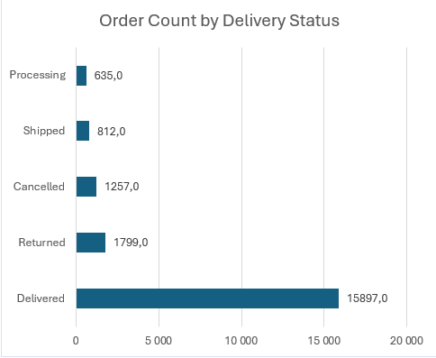

## Observation
Out of 4,994 registered customer accounts, 4,217 customers (84.4%) placed at least one order, while 777 customers (15.6%) never made a purchase.
This suggests that the company converts most registered users into paying customers, but there is still an opportunity to activate customers who registered but never completed an order.
A notable finding is that 1,435 customers had at least one returned order, which may indicate issues with product fit, quality, product descriptions, or customer expectations.

## Recommendation
Create targeted campaigns for the 777 registered customers who have never placed an order, such as welcome discounts or first-purchase incentives.
The company should also investigate the reasons behind returned and cancelled orders, especially in categories with high sales volumes. Reducing returns and cancellations could improve customer satisfaction and increase profitability without acquiring new customers.

## Question 7: Which product categories have the highest return rate?

  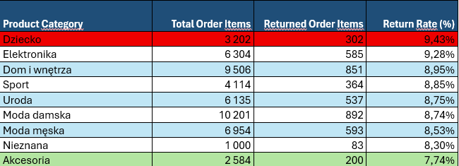

## Observation
The Children category has the highest return rate (9.43%). Although it generates relatively low revenue, it has one of the highest margins. This suggests that reducing returns in this category could improve profitability.
Electronics requires special attention. It generates the highest revenue, but has the lowest average margin and the second-highest return rate (9.28%). High returns combined with low margins may significantly reduce profits in the company's most important category.
On the other hand, Accessories have the lowest return rate (7.74%) and the highest average margin (56.06%). Although this category generates relatively low revenue, its strong profitability and low return rate make it one of the most promising categories for future growth.

## Recommendation
Investigate the reasons for returns in the Children and Electronics categories and review pricing and discount policies for Electronics. At the same time, increase the visibility of Accessories, especially as recommended products for Electronics purchases, as this category offers high margins and low return rates.

## Question 8: Which marketing channels generate the highest customer lifetime value (LTV)?
 

  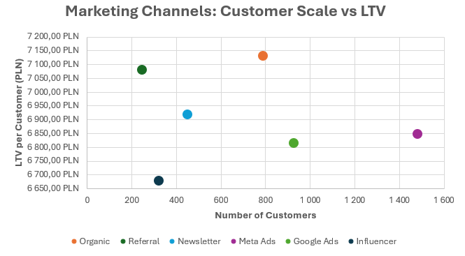

## Observations
Meta Ads generates the highest revenue (PLN 10.1M) and the largest customer base (1,481 customers). However, despite receiving 42% of the marketing budget, it does not generate the highest customer lifetime value (LTV). Its LTV (PLN 6,848 per customer) is lower than Organic, Referral, and Newsletter customers.
Organic customers have the highest LTV (PLN 7,131 per customer) even without paid acquisition costs. Referral customers also show strong performance with an LTV of PLN 7,081 per customer.

## Recommendation
Meta Ads remains an important channel because it generates the highest revenue and customer volume. However, despite receiving 42% of the marketing budget, it does not generate the highest customer lifetime value (LTV).
Before reallocating marketing spend, the company should calculate Customer Acquisition Cost (CAC) for each channel and compare it with LTV. This would help determine which channels deliver the best return on marketing investment.
At the same time, the company should consider increasing focus on Organic and Referral channels, as they generate the highest-value customers and may provide a better long-term return.

## Question 10: Which products are at risk of running out of stock next month?
 

  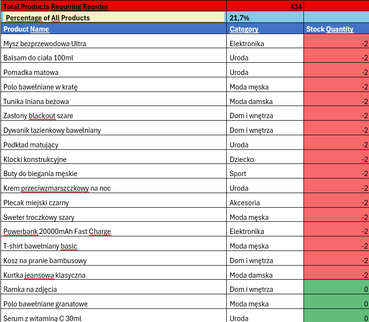

## Observation
A total of 434 active products (22% of the product catalog) have stock levels at or below the reorder point. This means a large number of products may soon run out of stock.
In addition, some products have negative stock levels, which may indicate inventory errors or problems with the stock recording process.

## Recommendation
The company should review its inventory management process and investigate the cause of negative stock levels. Automatic reorder alerts should be introduced to help prevent stock shortages. Priority should be given to products with zero or negative stock and products with high sales volume.

## Question 11: Are best-selling products at risk of stock shortages?
 

  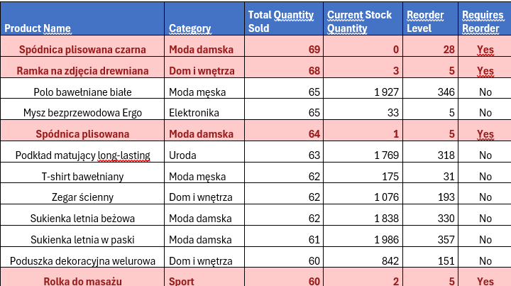

## Observation
Among the 20 best-selling products, 4 products already require reorder, including products with zero or very low stock levels. This confirms the findings from the previous analysis that inventory management may be a significant issue.
The fact that some top-selling products are close to being out of stock increases the risk of lost sales and lower customer satisfaction.
## Recommendation
The company should investigate the inventory and replenishment process more closely, as the results suggest possible issues with stock planning, inventory tracking, or product ordering. This problem should be reported to the operations or supply chain team for further investigation.
Priority should be given to best-selling products that are already below their reorder level to prevent future stock shortages and lost revenue.

## Question 13: Which products may be overstocked?
 

  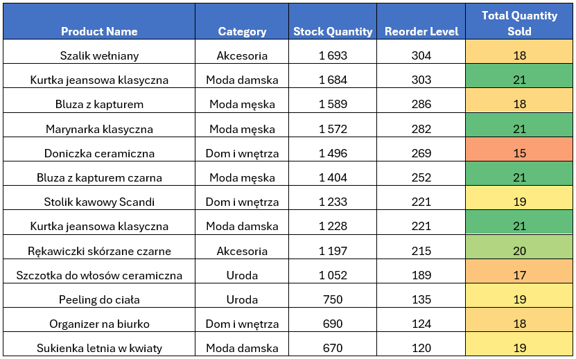

## Observations
A total of 830 products have a stock level above 500 units. Several of these products have very high inventory levels despite relatively low sales volumes. For example:
•	Szalik wełniany: 1,693 units in stock, only 18 units sold
•	Bluza z kapturem: 1,589 units in stock, only 18 units sold
This suggests that the company may be overstocking some products while facing shortages for others. Combined with the previous analysis, this indicates potential weaknesses in inventory planning and demand forecasting.
## Recommendation
The company should review its inventory planning process and identify products with high stock levels but low sales. Reducing future orders for slow-moving products could free up warehouse space and working capital.
These results support the findings from the previous analysis and suggest that the inventory and replenishment process should be reviewed by the operations team to better align stock levels with actual customer demand.

## <h1 align="center">Key Business Conclusions</h1>

## 1. Electronics is the main revenue driver, but also the biggest profitability risk
Electronics generates 37% of total revenue (PLN 10.7M), making it the company's most important category. However, it also has the lowest average margin (35.4%) and the second-highest return rate (9.28%).
In addition, all products with the lowest realized margins belong to this category. This suggests that Electronics should remain a strategic priority, but pricing, discount, and return policies require further review.

## 2. Accessories offer the strongest growth opportunity
Accessories generate relatively low revenue, but they have the highest average margin (56.1%) and the lowest return rate (7.74%).
This makes Accessories one of the most profitable categories in the business. A cross-selling strategy that promotes accessories alongside Electronics products could increase profitability without significantly increasing marketing costs.

## 3. Inventory management requires immediate attention
The analysis revealed two major inventory issues:
•	434 products (22% of the catalog) require reorder.
•	830 products have stock levels above 500 units despite low sales performance.
At the same time, several best-selling products are already below their reorder level. This suggests weaknesses in inventory planning, demand forecasting, or replenishment processes.

## 4. Customer acquisition channels differ in quality
Meta Ads generates the highest revenue and the largest number of customers. However, despite receiving 42% of the marketing budget, it does not generate the highest customer lifetime value (LTV).
Organic and Referral customers have the highest LTV, suggesting that customer quality differs across acquisition channels. Before changing marketing budgets, the company should compare CAC and LTV for each channel to identify the best long-term return on investment.

## 5. Customer activation is a bigger opportunity than retention
Out of 4,994 registered customers, 777 customers (15.6%) have never placed an order.
At the same time, 45.3% of customers make a second purchase within 90 days, indicating that many customers continue buying after their first completed order.
This suggests that activating registered but inactive customers may be a faster growth opportunity than focusing only on retention initiatives.

  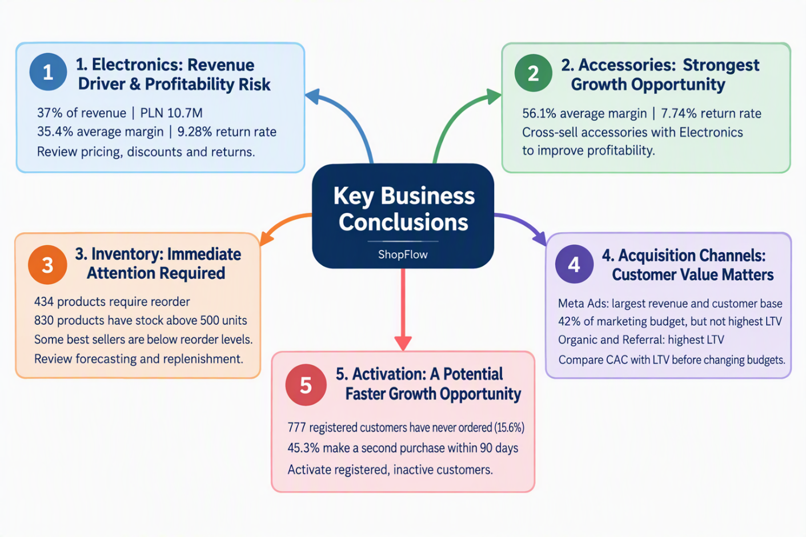

 
## <h1 align="center">Final Summary</h1>
ShopFlow's biggest opportunities are improving the profitability of Electronics, expanding sales of high-margin Accessories, optimizing inventory management, and making marketing decisions based on customer value rather than acquisition volume alone. Addressing these areas could improve both profitability and long-term growth.

